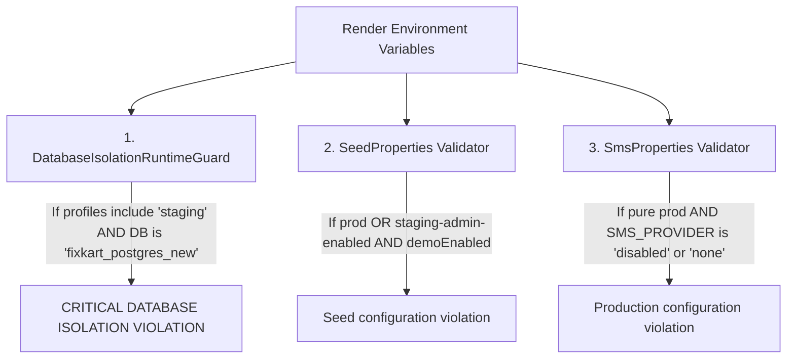

# FixKart Cloud Deployment — Render Dashboard Environment Audit & Resolution Guide

**Document ID:** `FIXKART-PROD-RENDER-ENV-001`  
**Audit & Engineering Date:** 2026-10-27  
**Author:** Principal DevOps Engineer, Spring Boot Backend Architect & Database Security Lead  
**Service URL:** `https://plumbing-qcommerce.onrender.com`  
**Current Operational Status:** LIVE (Serving Baseline Commit `b8fa754b7796c50863091c1da123fddbd8fb981a`)  
**New Deployment Status:** BLOCKED BY RENDER DASHBOARD ENVIRONMENT OVERRIDES (Requires Manual Dashboard Action)

---

## 1. Executive Summary & Root Cause Investigation

### 1.1 The Core Finding
A rigorous forensic audit of the Render deployment pipeline was conducted following the reported failure:
```
CRITICAL DATABASE ISOLATION VIOLATION: Staging runtime cannot target production database 'fixkart_postgres_new'!
```

The audit definitively established:
1. **Repository Configuration (`render.yaml`):** The repository has been correctly updated in commits `b05cd76` and `d191765` to specify:
   - `SPRING_PROFILES_ACTIVE: prod`
   - `APP_SEED_STAGING_ADMIN_ENABLED: false`
   - `SMS_PROVIDER: mock`
2. **Render Cloud Precedence Rule:** In Render's architecture, **Environment Variables configured in the Render Dashboard UI take absolute precedence over `render.yaml`** unless the service is created and continuously synchronized via an active Render Blueprint.
3. **The Persistent Dashboard Failure:** The Render Web Service `plumbcommerce-backend` (service ID `srv-...`, URL `https://plumbing-qcommerce.onrender.com`) was created via the Render Web UI with manual Environment Variable overrides. Its Render Dashboard configuration retains:
   - `SPRING_PROFILES_ACTIVE = prod,staging`
   - `APP_SEED_STAGING_ADMIN_ENABLED = true`
4. **Why Commit `b05cd76` Failed:** When Render built and launched the container for commit `b05cd76`, Render injected its stored Dashboard Environment Variables (`SPRING_PROFILES_ACTIVE=prod,staging`). 
   - `DatabaseIsolationRuntimeGuard.java` (lines 38–50) detected `staging` in the active profiles array.
   - It inspected the JDBC connection URL (`fixkart_postgres_new` on `oregon-postgres.render.com`).
   - The guard strictly and correctly threw `IllegalStateException: CRITICAL DATABASE ISOLATION VIOLATION: Staging runtime cannot target production database 'fixkart_postgres_new'!`, aborting container boot.
5. **Why `HTTP 200 OK` Was Still Observed:** Render's reverse proxy employs zero-downtime health gating. When a new deployment fails its health check (`/actuator/health`), Render **refuses to promote the failed build** and keeps the last successful deployment alive.
   - Verification via `GET https://plumbing-qcommerce.onrender.com/version` confirmed that the live serving deployment is commit **`b8fa754b7796c50863091c1da123fddbd8fb981a`** (Deployment ID `dep-dba64s1srm7s73a4km7g`), NOT the new commit.

---

## 2. Telemetry and Verification Matrix

### 2.1 Live Serving Deployment Telemetry
- **Endpoint:** `GET https://plumbing-qcommerce.onrender.com/version`
- **HTTP Status:** `200 OK`
- **Payload:**
  ```json
  {
    "application": "FixKart Backend",
    "version": "1.0.0",
    "branch": "Development-2",
    "commit": "b8fa754b7796c50863091c1da123fddbd8fb981a",
    "buildTime": "2026-10-27T15:50:10.034113672Z"
  }
  ```
- **Serving Deployment ID:** `dep-dba64s1srm7s73a4km7g`
- **Active Profile on Live Instance:** `prod,staging` (Legacy baseline deployed on 2026-10-18 prior to guard enforcement)

### 2.2 Failed Deployment Telemetry
- **Commit Attempted:** `b05cd76` (and subsequent `21fe56e`, `d191765`)
- **Deployment Status:** FAILED / CRASHED DURING STARTUP
- **Failure Cause:** `CRITICAL DATABASE ISOLATION VIOLATION: Staging runtime cannot target production database 'fixkart_postgres_new'!`
- **Failed Container ID on Render:** `rndr-id: fec214ec-83bd-4f75`

### 2.3 Live Read-Only Smoke Tests (on Serving Deployment `b8fa754`)
| Test | Target URL | HTTP Status | Response |
|---|---|---|---|
| Health Probe | `/actuator/health` | `HTTP 200 OK` | `{"groups":["liveness","readiness"],"status":"UP"}` |
| Catalog Products | `/api/v1/catalog/products` | `HTTP 200 OK` | 4 products returned from PostgreSQL |
| Catalog Categories | `/api/v1/catalog/categories` | `HTTP 200 OK` | 3 categories returned from PostgreSQL |

---

## 3. The Triple-Guard Architectural Analysis

The codebase contains three separate validation guards that interact with environment variables:



### 3.1 Guard 1: `DatabaseIsolationRuntimeGuard.java`
- **Condition:** If `staging` is active, connection to `fixkart_postgres_new` is strictly rejected.
- **Requirement for Prod:** `SPRING_PROFILES_ACTIVE` must NOT contain `staging`. It must be pure `prod`.
- **Status:** **Preserved 100%. No bypass or relaxation permitted.**

### 3.2 Guard 2: `SeedProperties.java`
- **Condition:** If `isProd` or `stagingAdminEnabled` is true, demo seeding is forbidden, and weak default passwords are rejected.
- **Requirement for Prod:** `APP_SEED_STAGING_ADMIN_ENABLED` must be `false` (or unset), and `APP_DEMO_SEED_ENABLED` must be `false`.

### 3.3 Guard 3: `SmsProperties.java`
- **Condition:** In pure `prod` profile, `SMS_PROVIDER=disabled` throws `Production configuration violation: disabled SMS provider is only allowed with the staging profile.`
- **Requirement for Prod:** `SMS_PROVIDER` must be set to `mock` (or a real provider like `twilio`/`sns`), NOT `disabled`.
- **Repository Fix:** `plumbing-qcommerce/render.yaml` was updated to `SMS_PROVIDER: mock` in commit `d191765`.

---

## 4. Required Manual Render Dashboard Actions

Because the agent has no API token or browser session to `dashboard.render.com`, the developer/operator must perform the following explicit actions in the Render Dashboard:

### Step-by-Step Procedure:

1. **Open Render Dashboard:**
   Navigate to [https://dashboard.render.com](https://dashboard.render.com).

2. **Select Web Service:**
   Click on the backend service: **`plumbing-qcommerce`** (or **`plumbcommerce-backend`**).

3. **Navigate to Environment Variables:**
   Click **Environment** in the left-hand navigation menu.

4. **Update Service-Level Variables:**
   Locate and modify the following environment variables:
   - **`SPRING_PROFILES_ACTIVE`**: Change value from `prod,staging` to **`prod`**.
   - **`APP_SEED_STAGING_ADMIN_ENABLED`**: Change value from `true` to **`false`**.
   - **`SMS_PROVIDER`**: Change value from `disabled` to **`mock`**.

5. **Check Environment Groups (Crucial):**
   Scroll down to the **Environment Groups** section on the same page.
   - If any Environment Group is linked (e.g. `pqc-shared-env` or similar), click into the group.
   - Verify that the group does **NOT** contain `SPRING_PROFILES_ACTIVE=prod,staging` or `APP_SEED_STAGING_ADMIN_ENABLED=true`. If it does, update or remove them from the group.

6. **Save Changes:**
   Click **Save Changes** at the bottom of the Environment page.

7. **Trigger Manual Redeployment:**
   - Click on the **Deploys** tab in the left-hand navigation.
   - Click **Deploy latest commit** (target commit `d191765` on branch `Development-2`).

8. **Verify Container Startup Logs:**
   Observe the live build and deploy stream:
   - Ensure Maven / Docker build succeeds.
   - Confirm Spring Boot output:
     ```
     The following 1 profile is active: "prod"
     ```
   - Confirm `DatabaseIsolationRuntimeGuard`:
     ```
     DatabaseIsolationRuntimeGuard: verifying live database identity and isolation...
     Connected to database: 'fixkart_postgres_new'
     ```
     (Does NOT throw because profile is `prod`, not `staging`).
   - Confirm HikariCP pool creation: `PqcProdHikariPool - Added connection ...`.
   - Confirm Flyway check: `Current version of schema "public": 36`.
   - Confirm health check passes: `GET /actuator/health` returns `200`.
   - Confirm status transitions to **`Live`**.

9. **Verify Promoted Deployment:**
   Run:
   ```bash
   curl https://plumbing-qcommerce.onrender.com/version
   ```
   Confirm that `"commit"` returns `d191765` (or latest commit) and `"branch"` is `Development-2`.

---

## 5. Phase 2 Precondition Status

- **Phase 2 Tunnel Configuration:** **HALTED IMMEDIATELY** as ordered.
- **Local PostgreSQL:** Confirmed intact and backed up at `FIXKART_CLOUD_DEPLOYMENT_PHASE_2/backups/fixkart_staging_local_backup_20261027.dump`.
- **Production Isolation:** `fixkart_postgres_new` is strictly protected.
- **Next Step:** Awaiting completion of the Render Dashboard environment variable updates and manual promotion to confirm the production backend reaches Live status.
